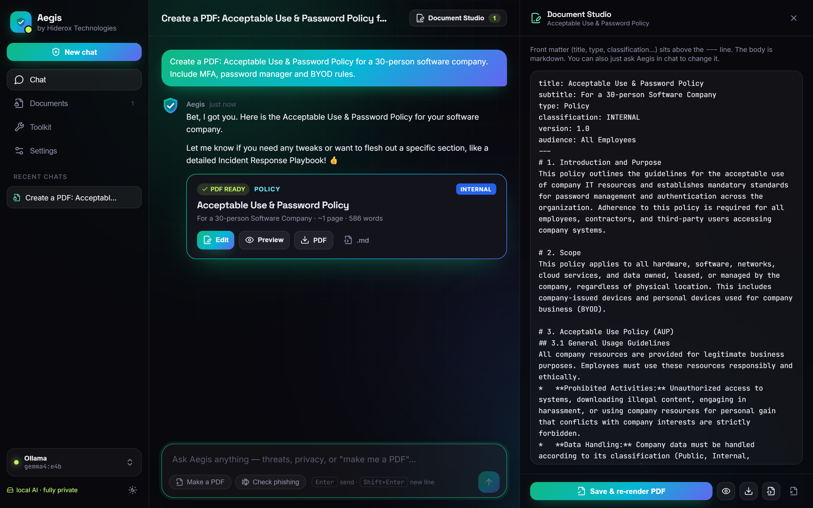
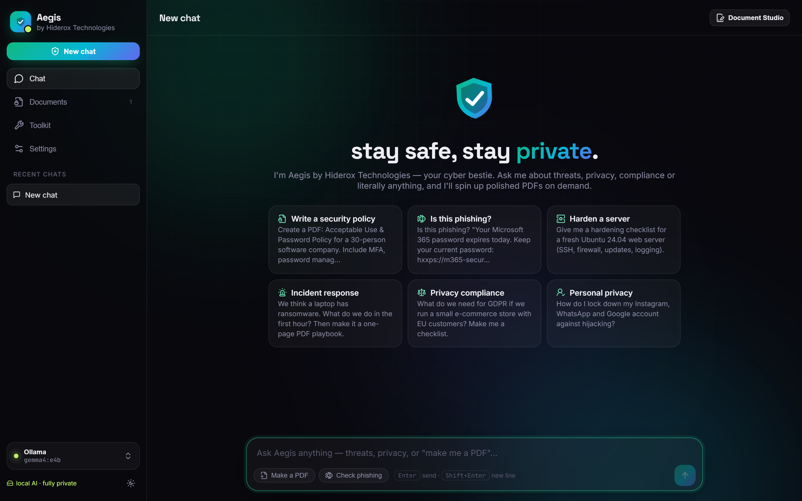
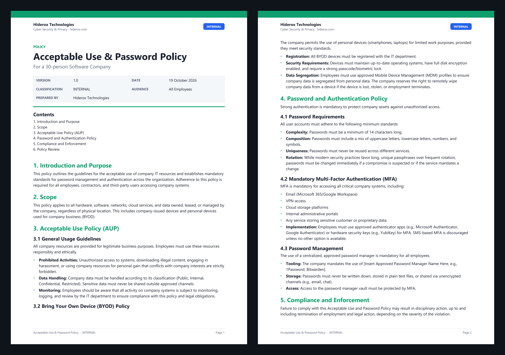
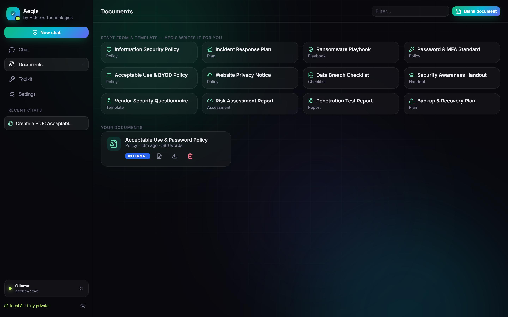
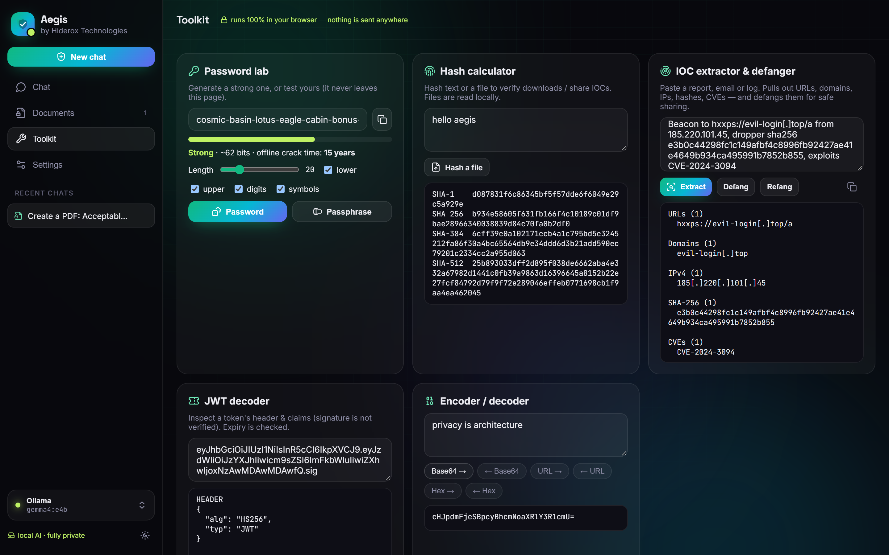
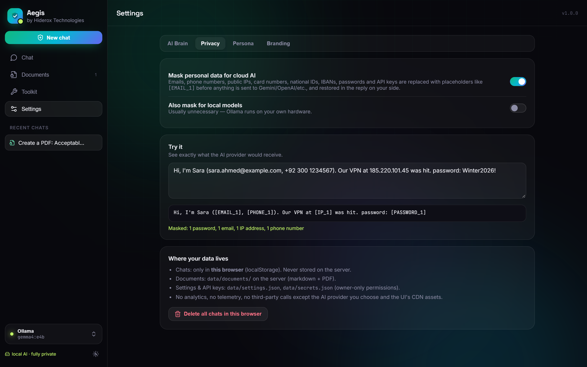
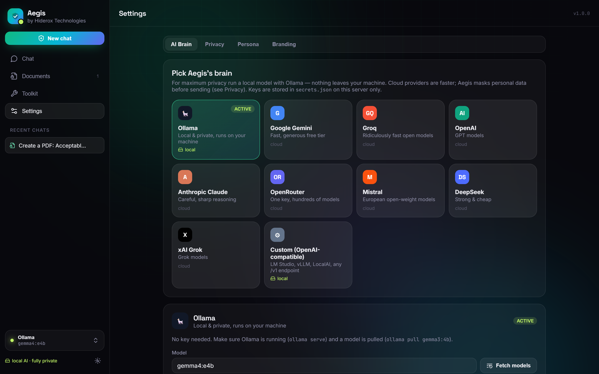
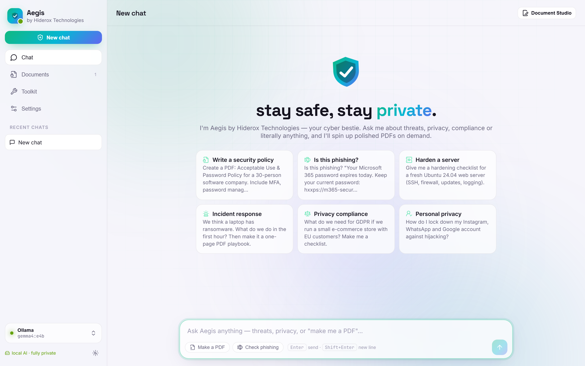
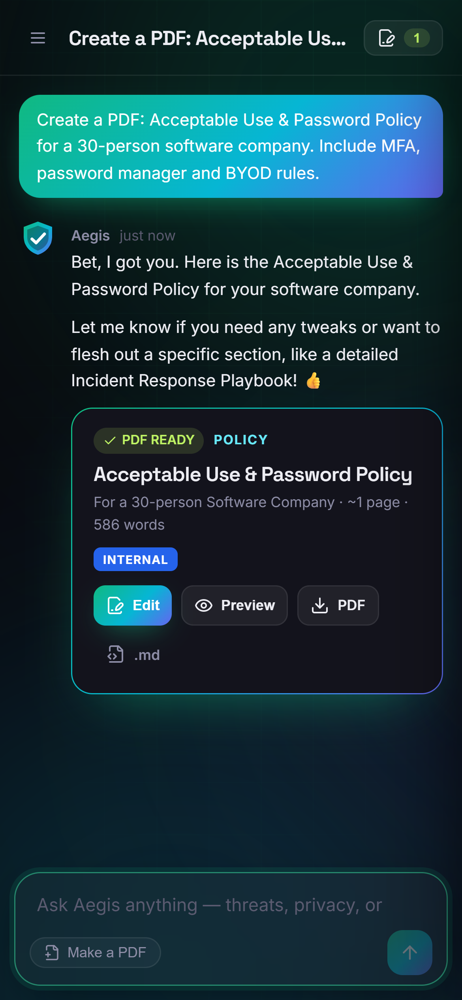

<div align="center">


# Hiderox Aegis — Open-Source AI Cybersecurity & Privacy Assistant

**Self-hosted, private AI security copilot that answers cybersecurity, privacy and compliance questions and writes professional PDF security documents on demand.**
Runs 100% locally with Ollama, or with Gemini, Groq, OpenAI, Claude and more, with personal data automatically masked before it leaves your machine.

[](LICENSE)
[](https://www.python.org/)
[](#-deploy-on-a-linux-server-one-command)
[](#-privacy-by-design)
[](https://hiderox.com)

[Features](#-features) · [Screenshots](#-screenshots) · [Quick start](#-quick-start) · [Deploy](#-deploy-on-a-linux-server-one-command) · [FAQ](#-faq) · [Support](#-support--contact)



</div>

---

## What is Hiderox Aegis?

**Hiderox Aegis** is a free, open-source **AI cybersecurity assistant** and **privacy copilot** you host on your own server or laptop.
Ask it about incident response, phishing, hardening, GDPR or ISO 27001, or anything else, and get clear answers.
Ask for an **information security policy, incident response plan, ransomware playbook, risk assessment or privacy notice** and it produces a **branded, ready-to-share PDF** in seconds.

Most AI chatbots require pasting sensitive incident details, IP addresses and customer data into someone else's cloud.
Aegis is built the other way round:

- **Private AI by default:** run a local LLM with [Ollama](https://ollama.com) and nothing leaves your infrastructure.
- **Cloud AI made safe:** when you choose Gemini, Groq, OpenAI or Anthropic, Aegis **redacts PII and secrets** (emails, phone numbers, IPs, card numbers, national IDs, IBANs, passwords, API keys) before sending, and restores them in the reply on your side.
- **No telemetry, no accounts, no lock-in:** MIT licensed, your data stays in your folder.

Built and maintained by **[Hiderox Technologies](https://hiderox.com)**, a privacy engineering and secure infrastructure company.

## ✨ Features

### 🛡️ AI security & privacy expert
- **Cybersecurity Q&A:** hardening for Windows, Linux, macOS, Microsoft 365, Google Workspace and cloud; IAM, MFA and passkeys; EDR, SIEM, logging, backups and vulnerability management.
- **Incident response:** triage, containment, evidence handling, ransomware, business email compromise (BEC) and account takeover.
- **Phishing & scam analysis:** paste an email, SMS, link or headers and get the red flags explained.
- **Privacy & compliance:** GDPR, UK GDPR, CCPA/CPRA, HIPAA, PCI DSS, Pakistan PECA, DPIAs, retention and data-subject requests.
- **Frameworks:** ISO 27001/27701, SOC 2, NIST CSF 2.0, CIS Controls, OWASP Top 10/ASVS and MITRE ATT&CK.
- **Secure development:** code review, STRIDE threat modelling, secrets management and supply-chain security.
- **Personal privacy:** account security, data-broker removal and social media lockdown.
- **Plus everyday help:** general IT, DevOps, writing, research and more.

### 📄 AI document generator: security policies & reports as PDF
- Type *"make me an incident response plan"* and get a **branded PDF** with:
  - a cover block and classification badge (PUBLIC / INTERNAL / CONFIDENTIAL / RESTRICTED, or TLP),
  - a table of contents, tables, checklists, warning and tip callouts, and code blocks.
- **Document Studio:** edit the markdown source beside the chat and re-render instantly, or ask Aegis to revise it.
- **12 one-click templates:**
  - Information Security Policy, Incident Response Plan, Ransomware Playbook, Password & MFA Standard
  - Acceptable Use & BYOD Policy, GDPR Privacy Notice, Data Breach Checklist, Security Awareness Handout
  - Vendor Security Questionnaire, Risk Assessment Report, Penetration Test Report, Backup & Disaster Recovery Plan
- Download as **PDF** or **Markdown**.

### 🔒 Privacy by design
- **Local LLM support** (Ollama) for fully air-gapped use.
- **Reversible PII redaction** for cloud LLMs, with a live preview of exactly what the provider receives.
- Chats are stored **only in your browser**; no server-side chat logs.
- Optional **access-token login** with brute-force lockout, plus HttpOnly/SameSite cookies, CSP and security headers.

### 🧰 Built-in security toolkit (runs in your browser)
Password & passphrase generator with crack-time estimate · SHA-1/256/384/512 file & text hashing · **IOC extractor** with defang/refang (URLs, domains, IPs, hashes, CVEs) · **JWT decoder** with expiry and `alg: none` warnings · Base64 / URL / Hex encoder.

### ⚙️ Works with any LLM
**Ollama** (Gemma, Llama, Qwen, Mistral…) · **Google Gemini** · **Groq** · **OpenAI** · **Anthropic Claude** · **OpenRouter** · **Mistral** · **DeepSeek** · **xAI Grok** · any **OpenAI-compatible** endpoint (LM Studio, vLLM, LocalAI).
Switch models from the UI, no restart needed.

### 🎨 Personas & white-label branding
- Choose a **Gen-Z**, **Friendly** or **Professional** chat tone, and add your own "house rules".
- Set your organisation name, logo, accent colour and default classification for every PDF.
- Fork it and **rebrand it for your own MSP or security consultancy**.

## 📸 Screenshots

| Home | Chat + Document Studio |
|---|---|
|  |  |
| **Generated PDF** | **Document templates** |
|  |  |
| **Security toolkit** | **PII redaction for cloud AI** |
|  |  |
| **Choose any AI provider** | **Light mode** |
|  |  |

<p align="center"></p>

## 🚀 Quick start

```bash
git clone https://github.com/hiderox/aegis-ai-security-assistant.git
cd aegis-ai-security-assistant
./run.sh            # Windows: run.bat
```

Open **http://127.0.0.1:8080** and choose a model in **Settings → AI Brain**:
- **Fully private:** install [Ollama](https://ollama.com), then `ollama pull gemma3:4b`.
- **Fastest to try:** paste a free [Google Gemini](https://aistudio.google.com/apikey) or [Groq](https://console.groq.com/keys) API key.

Requirements: Python 3.10+. A GPU is optional; local models also run on CPU, just more slowly.

## 🐧 Deploy on a Linux server (one command)

```bash
sudo ./deploy/deploy.sh                       # localhost:8080, installs Ollama + gemma3:4b
sudo ./deploy/deploy.sh --public              # listen on all interfaces (access token generated)
sudo ./deploy/deploy.sh --model qwen3:8b --port 9000
sudo ./deploy/deploy.sh --no-ollama           # cloud AI only
sudo ./deploy/deploy.sh --uninstall --purge   # remove everything
```

The installer supports **Ubuntu, Debian, RHEL, Rocky, AlmaLinux, Fedora, Arch and openSUSE**. It:
1. installs system packages and fonts;
2. ensures **Python 3.10+**;
3. installs **Ollama** and pulls your model;
4. creates a **virtualenv** in `/opt/hiderox-aegis`;
5. generates an **access token**;
6. registers a hardened **systemd service** (dedicated user, `ProtectSystem=strict`, `NoNewPrivileges`, no capabilities) that starts on boot.

```bash
systemctl status hiderox-aegis          # service status
journalctl -u hiderox-aegis -f          # live logs
sudo nano /etc/hiderox-aegis/aegis.env  # config (then: systemctl restart hiderox-aegis)
```

> **Exposing it to the internet?** Put it behind HTTPS (Caddy or nginx) and set `AEGIS_SECURE_COOKIES=1`.

## 🔧 Configuration

| Variable | Default | Description |
|---|---|---|
| `AEGIS_HOST` / `AEGIS_PORT` | `127.0.0.1` / `8080` | Listen address |
| `AEGIS_DATA_DIR` | `./data` | Documents, settings, API keys, session secret |
| `AEGIS_ACCESS_TOKEN` | *(empty)* | Enables login + `Authorization: Bearer` API auth |
| `AEGIS_SECURE_COOKIES` | `0` | Set `1` behind HTTPS |
| `OLLAMA_BASE_URL` / `OLLAMA_MODEL` | `http://localhost:11434` / `gemma4:e4b` | Local LLM |
| `GEMINI_API_KEY`, `GROQ_API_KEY`, `OPENAI_API_KEY`, `ANTHROPIC_API_KEY`, `OPENROUTER_API_KEY`, `MISTRAL_API_KEY`, `DEEPSEEK_API_KEY`, `XAI_API_KEY` | | Cloud keys (or add them in the UI) |

## 🏗️ How it works

```
Browser (chats in localStorage) ──SSE──► Flask
                                           ├─ agent.py ─► redact.py (mask PII for cloud) ─► llm_service.py
                                           │                 Ollama · OpenAI-compatible · Anthropic
                                           └─ model writes a ```document block (front matter + markdown)
                                                 └─► doc_renderer.py (ReportLab) ─► branded PDF in data/documents/
```

Aegis doesn't rely on provider-specific function calling, so it works well with **small local models**.
The model writes a fenced `document` block, and the server hides it from the chat, restores any redacted values, and renders the PDF.

<details>
<summary><b>REST API</b></summary>

| Endpoint | Description |
|---|---|
| `POST /api/agent/chat` | Server-Sent Events: `status`, `privacy`, `token`, `document`, `document_error`, `final`, `error`, `done` |
| `GET /api/documents` · `POST /api/documents` | List documents · render markdown → PDF (`{source, id?}`) |
| `GET /api/documents/<id>.pdf` · `.md` · `/<id>/source` | Download / read source |
| `DELETE /api/documents/<id>` | Delete |
| `POST /api/privacy/preview` | Preview PII redaction |
| `/api/ai/*` · `/api/settings` · `/api/branding/logo` | Configuration |

With `AEGIS_ACCESS_TOKEN` set, send `Authorization: Bearer <token>`.
</details>

## ❓ FAQ

**Is Hiderox Aegis free?**
Yes. It's open source under the MIT license, free for personal and commercial use.

**Can I use it completely offline / air-gapped?**
Yes. Use Ollama with a local model (e.g. `gemma3:4b`, `qwen3:8b`, `llama3.1:8b`). The UI loads fonts and icons from public CDNs; vendor them locally for a fully offline setup.

**Is my data sent to OpenAI or Google?**
Only if you choose a cloud provider. Even then, emails, phone numbers, public IPs, card numbers, national IDs, IBANs, passwords and API keys are **masked before sending** and restored on your side. The default is local Ollama, where nothing leaves your machine.

**What documents can it write?**
Security policies, incident response plans, playbooks, standards, checklists, risk assessments, pentest report templates, privacy notices, awareness handouts, vendor questionnaires, DR plans, or any custom document you describe.

**Which local model should I use?**
- `gemma3:4b` for laptops and CPUs.
- `qwen3:8b` or `llama3.1:8b` for better documents.
- Larger models if you have a GPU.

**Can I rebrand it for my company or MSP?**
Yes. Change the name, logo, colours and classification defaults in Settings → Branding. The MIT license allows commercial use.

**Will it help with hacking?**
No. Aegis is a **defensive** tool. It supports defenders, students and **authorised** testers, and declines to help create malware, steal credentials or access systems without permission.

## 🤝 Support & Contact

Need help deploying Aegis, a private on-premise LLM, or a security assessment? Talk to the team behind it:

| Channel | |
|---|---|
| 🌐 Website | [hiderox.com](https://hiderox.com) |
| ✉️ Email | [info@hiderox.com](mailto:info@hiderox.com) |
| 💬 Telegram | [@hiderox](https://t.me/hiderox) (fastest response) |
| 📱 WhatsApp | [+44 7598 820751](https://wa.me/447598820751) |
| 💼 LinkedIn | [Hiderox Technologies](https://linkedin.com/company/hiderox-technologies) |
| 📅 Book a free 30-min consultation | [tidycal.com/hiderox](https://tidycal.com/hiderox) |
| 🐙 GitHub | [github.com/hiderox](https://github.com/hiderox) |

- **Bugs & feature requests:** open a [GitHub issue](../../issues).
- **Security vulnerabilities:** please report privately; see [SECURITY.md](SECURITY.md).

**Hiderox services:** privacy engineering · security audits · LLM red teaming & prompt-injection testing · private & on-premise LLM deployment · secure RAG & AI agents · hardware MFA · encrypted backup & disaster recovery · 24/7 monitoring. [Explore services →](https://hiderox.com/services)

## 🙌 Contributing

Contributions are welcome: new document templates, toolkit utilities, AI providers, translations and docs.
Fork the repo, create a branch and open a pull request. Please keep the privacy-first defaults intact.

## ⚖️ Responsible use & disclaimer

Aegis provides security guidance, **not legal advice**. Verify CVEs, regulations and configuration changes against official sources (NVD, vendor advisories, regulators) before acting.

## 📜 License

[MIT](LICENSE) © 2026 [Hiderox Technologies](https://hiderox.com). Free to use, modify and distribute.

<div align="center">

**If Aegis helps you, please ⭐ star the repo; it helps others find private, open-source security AI.**

<sub>Keywords: AI cybersecurity assistant · open-source security copilot · self-hosted AI · private LLM · local LLM Ollama · privacy AI · PII redaction · security policy generator · incident response plan template · ISO 27001 · GDPR compliance tool · SOC 2 · NIST CSF · phishing analysis · IOC extractor · ChatGPT alternative for security teams</sub>

</div>
